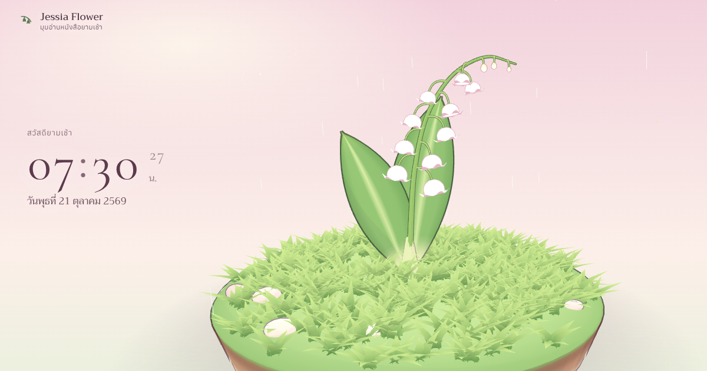

# Jessia Flower

มุมอ่านหนังสือ 3 มิติ มีช่อดอกระฆังแก้ว (ลิลลี่แห่งขุนเขา, *Convallaria majalis*) สไตล์การ์ตูนพาสเทล แตะดอกแล้วกระดิ่งดัง มีเสียงธรรมชาติ เพลงเบา ๆ นาฬิกา และเครื่องมือช่วยอ่านหนังสือ

**เว็บไซต์:** https://jessia-flower.vercel.app



## ฟีเจอร์

- **6 ฉาก:** เนินหญ้ายามเช้า, กระถางริมหน้าต่าง, สวนนอกบ้าน, ฝนพรำ, คืนหิ่งห้อย และระฆังแก้วแห่งรัก (ดอกแก้วใส ดอกรูปหัวใจ หัวใจลอย) เปลี่ยนฉากตามเวลาจริงได้
- **ฝนและเสียงธรรมชาติ:** ปรับปริมาณฝนได้ทุกฉาก ทั้งภาพและเสียง ปรับฝน ฟ้าร้อง นก จิ้งหรีด ใบหญ้า ลำธาร กบ กองไฟ และนาฬิกาเดินได้ทีละเสียง แต่ละฉากจำค่าของตัวเอง
- **เพลง:** แต่งสดตามคอร์ดของแต่ละฉาก ไม่วนซ้ำท่อนเดิม
- **นาฬิกา:** แบบตัวเลขหรือเข็ม เลือกฟอนต์ สี ขนาด และตำแหน่งได้ มีโหมดเต็มจอที่หน้าจอไม่ดับเอง
- **ช่วยอ่านหนังสือ:** ตัวจับเวลาอ่าน/พัก สถิติ 7 วัน หนังสือที่กำลังอ่านพร้อมความคืบหน้า โน้ตระหว่างอ่าน ตั้งเวลาปิดเสียง และโหมดหายใจผ่อนคลาย
- **ใช้ได้ทุกจอ:** คอม แท็บเล็ต และมือถือ เพิ่มไปหน้าจอหลักให้เหมือนแอปได้

## เทคโนโลยี

- เป็นไฟล์ HTML ไฟล์เดียว ไม่ต้อง build
- โมเดล 3 มิติใช้ [Three.js](https://threejs.org/) r128 แสงเงาแบบ toon 3 ขั้นพร้อมเส้นขอบ
- เสียงทั้งหมดสังเคราะห์สดด้วย Web Audio API ไม่มีไฟล์เสียง
- ข้อมูลการอ่านและโน้ตเก็บไว้ในเบราว์เซอร์ของแต่ละเครื่อง

## รันบนเครื่อง

เปิด `index.html` ตรง ๆ ได้เลย หรือเปิดผ่านเซิร์ฟเวอร์ไฟล์ทั่วไป เช่น

```bash
npx serve .
```

## ผู้สร้าง

สร้างโดย **Pakornkiet Puanpanwong** ([@PAKORNKIET](https://github.com/PAKORNKIET))
